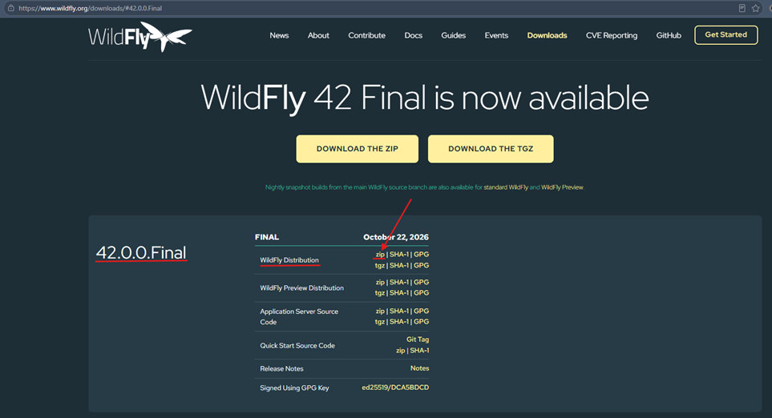

# 🌐 Jakarta EE 11: Jakarta RESTful Web Services (JAX-RS)

**JAX-RS** es la especificación de Jakarta EE para construir **APIs REST** con anotaciones (`@Path`, `@GET`, `@POST`,
`@Produces`...). Es una de las dos especificaciones más importantes en el camino hacia **Quarkus**, junto con CDI.

> 📌 **Contexto del proyecto:** a partir de esta sección el curso deja de usar **Tomcat** y pasa a **WildFly**, un
> servidor de aplicaciones completo. Esto cambia cómo se configura el proyecto, como veremos a continuación.

---

## 🖥️ Instalando el servidor WildFly

### 🤔 ¿Qué es WildFly?

**WildFly** es un **servidor de aplicaciones Jakarta EE** desarrollado por Red Hat. A diferencia de Tomcat, que es solo
un contenedor web (Servlet/JSP), `WildFly` **ya incluye** las implementaciones de la plataforma:

| Especificación | Implementación incluida en WildFly |
|----------------|------------------------------------|
| Servlet        | Undertow                           |
| CDI            | Weld                               |
| JPA            | Hibernate                          |
| JAX-RS         | RESTEasy                           |
| EJB, JTA       | Incluidos en el propio servidor    |

Por eso, en este proyecto **no necesitamos agregar Weld ni Hibernate como dependencias**.

### 📥 Pasos de instalación

1. Ingresamos a la página de WildFly: https://www.wildfly.org/
2. Vamos a la sección de descargas: https://www.wildfly.org/downloads/
3. Descargamos el `.zip` de **WildFly Distribution** en la versión
   [42.0.0.Final](https://www.wildfly.org/downloads/#42.0.0.Final).

   

   > [Especificaciones admitidas](https://www.wildfly.org/news/2026/10/22/WildFly-42-is-released/)  
   > La versión estándar de `WildFly 42` es compatible con la plataforma `EE 11`, así como con Web Profile y Core
   > Profile. `WildFly` es compatible con la plataforma `EE 11`, Web Profile y Core Profile cuando se ejecuta sobre Java
   > SE 17 y Java SE 21.
   >
   > No afirmamos que exista compatibilidad con EE 11 en SE 25. Los resultados obtenidos al ejecutar los TCK en SE 25
   > nos parecen satisfactorios, por lo que `consideramos adecuado recomendar SE 25` como la versión de SE para la
   > edición estándar de WildFly 42. No obstante, si para usted es importante ejecutar WildFly en una versión de SE que
   > supere los TCK de EE, le sugerimos utilizar SE 21 o 17.

4. Descomprimimos `wildfly-42.0.0.Final.zip` en el disco `C:\`.
    ````bash
    C:\wildfly-42.0.0.Final
    $ ls -l
    total 589
    drwxr-xr-x 1 magadiflo 197121      0 Oct 21 17:35 appclient/
    drwxr-xr-x 1 magadiflo 197121      0 Oct 21 17:35 bin/
    -rw-r--r-- 1 magadiflo 197121  19358 Oct 21 17:35 copyright.txt
    drwxr-xr-x 1 magadiflo 197121      0 Oct 21 17:35 docs/
    drwxr-xr-x 1 magadiflo 197121      0 Oct 21 17:36 domain/
    -rw-r--r-- 1 magadiflo 197121 439959 Oct 21 17:35 jboss-modules.jar
    -rw-r--r-- 1 magadiflo 197121  11356 Oct 21 17:35 LICENSE.txt
    drwxr-xr-x 1 magadiflo 197121      0 Oct 21 17:35 modules/
    -rw-r--r-- 1 magadiflo 197121   2223 Oct 21 17:35 README.txt
    -rw-r--r-- 1 magadiflo 197121 105226 Oct 21 17:36 sbom.cdx.json.gz
    drwxr-xr-x 1 magadiflo 197121      0 Oct 21 17:36 standalone/
    -rw-r--r-- 1 magadiflo 197121     30 Oct 21 17:35 version.txt
    drwxr-xr-x 1 magadiflo 197121      0 Oct 21 17:35 welcome-content/ 
    ````

#### 🗂️ ¿Qué contiene cada directorio?

| Directorio         | Para qué sirve                                                                                                      | Equivalente en Tomcat |
|--------------------|---------------------------------------------------------------------------------------------------------------------|-----------------------|
| `bin/`             | Scripts para iniciar, detener y administrar el servidor                                                             | `bin/`                |
| `standalone/`      | Configuración y despliegues del **modo standalone** (una sola instancia). Es el que usaremos                        | `conf/` y `webapps/`  |
| `domain/`          | Configuración del **modo domain** (varios servidores administrados juntos)                                          | No existe             |
| `modules/`         | Librerías del servidor organizadas como módulos (ahí vive el driver de base de datos que se instalará más adelante) | `lib/`                |
| `docs/`            | Documentación y esquemas                                                                                            | `webapps/docs`        |
| `welcome-content/` | Página de bienvenida del servidor                                                                                   | `webapps/ROOT`        |

> 📌 **Modo standalone vs domain:** para desarrollo y para este curso usamos **standalone**. El modo *domain* sirve para
> administrar varios servidores desde un punto central y se usa en infraestructuras grandes.

## ⚙️ Configurando WildFly en nuestra aplicación web

Creamos un nuevo proyecto `Maven` llamado `01-webapp-jaxrs`. Su `pom.xml`:

````xml
<?xml version="1.0" encoding="UTF-8"?>
<project xmlns="http://maven.apache.org/POM/4.0.0"
         xmlns:xsi="http://www.w3.org/2001/XMLSchema-instance"
         xsi:schemaLocation="http://maven.apache.org/POM/4.0.0 http://maven.apache.org/xsd/maven-4.0.0.xsd">
    <modelVersion>4.0.0</modelVersion>

    <groupId>dev.magadiflo</groupId>
    <artifactId>01-webapp-jaxrs</artifactId>
    <version>1.0-SNAPSHOT</version>

    <packaging>war</packaging>

    <properties>
        <maven.compiler.source>25</maven.compiler.source>
        <maven.compiler.target>25</maven.compiler.target>
        <project.build.sourceEncoding>UTF-8</project.build.sourceEncoding>
        <project.reporting.outputEncoding>UTF-8</project.reporting.outputEncoding>
    </properties>
    <dependencies>
        <!-- Jakarta EE 11 API -->
        <dependency>
            <groupId>jakarta.platform</groupId>
            <artifactId>jakarta.jakartaee-api</artifactId>
            <version>11.0.0</version>
            <scope>provided</scope>
        </dependency>
    </dependencies>
    <build>
        <finalName>${project.artifactId}</finalName>
        <plugins>
            <!-- Java Compiler -->
            <plugin>
                <groupId>org.apache.maven.plugins</groupId>
                <artifactId>maven-compiler-plugin</artifactId>
                <version>3.16.0</version>
            </plugin>

            <!-- WAR Packaging -->
            <plugin>
                <groupId>org.apache.maven.plugins</groupId>
                <artifactId>maven-war-plugin</artifactId>
                <version>3.5.1</version>
                <configuration>
                    <failOnMissingWebXml>false</failOnMissingWebXml> <!--Indica que el web.xml es opcional-->
                </configuration>
            </plugin>

            <!-- WildFly Deployment -->
            <plugin>
                <groupId>org.wildfly.plugins</groupId>
                <artifactId>wildfly-maven-plugin</artifactId>
                <version>6.2.0.Final</version>
            </plugin>
        </plugins>
    </build>

</project>
````

### 🔍 Dependencias

#### `jakarta.jakartaee-api` con `scope=provided`

Es la **única dependencia** del proyecto. Aquí `provided` sí tiene su significado completo: `WildFly` provee **toda**
la API de Jakarta EE en runtime, así que el `.war` no necesita llevarla.

|                                    | Tomcat                                                                          | WildFly                       |
|------------------------------------|---------------------------------------------------------------------------------|-------------------------------|
| **¿Qué provee el servidor?**       | Solo Servlet/JSP                                                                | Toda la plataforma Jakarta EE |
| **`jakartaee-api` con `provided`** | Insuficiente: en nuestro proyecto con CDI hubo que agregar `jakarta.inject-api` | Suficiente                    |
| **Implementación de CDI**          | No incluida: agregamos `weld-servlet-core`                                      | Weld ya viene incluido        |
| **Implementación de JPA**          | No incluida: habría que agregar Hibernate (en general, cualquier proveedor JPA) | Hibernate ya viene incluido   |

> 📌 **Regla general:** con Tomcat, todo lo que no sea Servlet/JSP (CDI, JPA, JAX-RS, etc.) hay que agregarlo
> como dependencia junto con su implementación. Con WildFly, el servidor ya trae las implementaciones, y por eso
> basta con `jakartaee-api` como `provided`.

### 🔍 Plugins

| Plugin                  | Qué hace                                                                                              |
|-------------------------|-------------------------------------------------------------------------------------------------------|
| `maven-compiler-plugin` | Compila con Java 25                                                                                   |
| `maven-war-plugin`      | Empaqueta el proyecto como `.war`                                                                     |
| `wildfly-maven-plugin`  | Despliega el `.war` en WildFly desde Maven. Reemplaza al `tomcat7-maven-plugin` del proyecto anterior |

#### `<finalName>${project.artifactId}</finalName>`

Define el nombre del archivo generado: `01-webapp-jaxrs.war`, sin el sufijo de versión (`-1.0-SNAPSHOT`). En WildFly el
nombre del `.war` determina el **context root** de la aplicación:

```
01-webapp-jaxrs.war  ──►  http://localhost:8080/01-webapp-jaxrs/
```

#### `<failOnMissingWebXml>false</failOnMissingWebXml>`

Indica que el `web.xml` es **opcional**. Desde Servlet 3.0 la configuración puede hacerse con anotaciones
(`@WebServlet`, `@ApplicationPath`...), por lo que muchos proyectos no necesitan ese archivo.

> 📝 En versiones recientes de `maven-war-plugin` esta propiedad ya no suele ser necesaria. Dejarla no causa problemas,
> pero verifica si tu versión la requiere.

### 🚀 Cómo se despliega

El `wildfly-maven-plugin` se comunica con el servidor mediante su **interfaz de administración** (puerto `9990` por
defecto), a diferencia de Tomcat, donde usábamos el *Manager* en `/manager/text`.

```
Tomcat:    tomcat7-maven-plugin  ──►  http://localhost:8080/manager/text  (usuario y contraseña)
WildFly:   wildfly-maven-plugin  ──►  localhost:9990 (administración)
```

Con el servidor levantado, el plugin puede desplegar con `mvn wildfly:deploy`.

> 📝 Los detalles de cómo iniciar WildFly y configurar el despliegue desde IntelliJ los documentaremos en el siguiente
> paso. Si tu entorno pide credenciales de administración, se crean con el script `add-user` del directorio `bin/`.

### 📊 Puertos y accesos de WildFly

Al iniciar WildFly con `standalone.bat`, el log confirma las interfaces del servidor. Este cuadro resume qué corre en
cada puerto y quién lo usa:

| Qué                                       | Dirección                | Quién lo usa                     |
|-------------------------------------------|--------------------------|----------------------------------|
| Página de bienvenida y **tu aplicación**  | `http://localhost:8080/` | Navegador, clientes HTTP         |
| **Consola de administración**             | `http://127.0.0.1:9990`  | Administrador desde el navegador |
| **Despliegue** con `wildfly-maven-plugin` | `localhost:9990`         | Maven                            |

```
Navegador     ──► 8080 ──► tu aplicación (ej. /01-webapp-jaxrs/)
Maven plugin  ──► 9990 ──► administración (despliegue del .war)
```

> ✅ **Confirmado en el log de inicio:** `Admin console listening on http://127.0.0.1:9990`. La administración solo
> escucha en `127.0.0.1`, por lo que únicamente es accesible desde la propia máquina.

#### 🆚 Comparación con Tomcat

|                                  | Tomcat                             | WildFly                                                             |
|----------------------------------|------------------------------------|---------------------------------------------------------------------|
| **Iniciar el servidor**          | `catalina.bat run`                 | `standalone.bat`                                                    |
| **Detener el servidor**          | `Ctrl + C`                         | `Ctrl + C`                                                          |
| **Puerto de la aplicación**      | `8080`                             | `8080`                                                              |
| **Administración y despliegue**  | `8080` (`/manager/text`)           | `9990`                                                              |
| **Autenticación para desplegar** | Usuario y contraseña del *Manager* | Acceso local sin credenciales (se crean con `add-user` si se piden) |

### 📊 Resumen — Tomcat vs WildFly

| Aspecto                        | Tomcat                                       | WildFly                           |
|--------------------------------|----------------------------------------------|-----------------------------------|
| **Tipo**                       | Contenedor web                               | Servidor de aplicaciones completo |
| **Especificaciones incluidas** | Servlet y JSP                                | Plataforma Jakarta EE completa    |
| **Dependencias del proyecto**  | `jakartaee-api` + Weld + `inject-api` + JSTL | Solo `jakartaee-api`              |
| **Plugin de despliegue**       | `tomcat7-maven-plugin`                       | `wildfly-maven-plugin`            |
| **Puerto de administración**   | 8080 (`/manager`)                            | 9990                              |

> 🔗 **Conexión con Quarkus:** Quarkus **no usa servidor de aplicaciones**. El servidor HTTP (Vert.x) va **embebido**
> en la propia aplicación, así que no instalas WildFly ni Tomcat: ejecutas `mvn quarkus:dev` y la aplicación se levanta
> sola, con recarga en vivo. Tampoco usas `jakartaee-api` como dependencia única, sino **extensiones** específicas (por
> ejemplo, para REST y CDI). Entender qué aporta WildFly te ayuda a ver qué reemplaza Quarkus: las implementaciones
> vienen **dentro de la aplicación**, no del servidor. ✅

